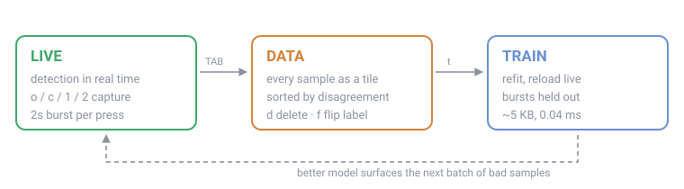

# blinkergate

Per-eye open/closed detection for Linux infrared (Windows Hello) cameras, with
the classifier enrolled on **your** camera and **your** eyes.

The goal it serves: a face match proves you are present, but not that you
consented. A deliberate eye gesture supplies the consent — useful for gating
`sudo` or a polkit prompt rather than merely unlocking a screen. This repo is the
detection layer that has to work first.



> **Before changing anything here, read [docs/FINDINGS.md](docs/FINDINGS.md) and
> [docs/PITFALLS.md](docs/PITFALLS.md).** The first is what has been measured on
> this hardware — frame rate, detector thresholds, what the classifier is brittle
> to. The second is the mistakes that produced confident wrong answers along the
> way, most of which are easy to repeat.

## Why enrol instead of shipping a model

Off-the-shelf infrared eye-state models exist and are good. On this hardware they
were measured at:

| detector | balanced accuracy | closed eyes caught |
|---|---|---|
| OCEC (all 6 size variants) | 50–63% | 0–68% |
| OCEC + CLAHE / equalize / contrast-stretch | 50% (chance) | 0% |
| OCEC + crop padding swept 1.0→3.0 | no improvement | — |
| **linear model fitted on this camera** | **97.7%** | **~98%** |
| **pooled kernels fitted on this camera** | **99.8%** | **~99%** |

The published models are trained on well-exposed close-up IR eyes. A laptop Hello
camera gives an ~18-pixel-wide, low-contrast, frequently oblique eye instead —
far outside that distribution. They fail *confidently*, returning 1.000 with no
uncertainty, which looks like a broken detector rather than an unsure one.
Contrast normalisation made it worse, pushing crops further from what they knew.

A logistic regression on raw pixels, fitted on ~300 crops from the sensor it runs
on, reaches 97.7% with **whole capture bursts held out** — scored only on poses it
never trained on. It is 5 KB and takes 0.04 ms for both eyes.

So: no thresholds you nudge by eye, no per-distance tuning. Just enrolment, the
same shape as Howdy already enrolling your face.

## Install

```sh
uv run fetch_model.py                        # MediaPipe face landmarker, ~3.6 MB
uv run eyetrainer.py --device /dev/video2    # live view + capture
uv run serve.py                              # labelling UI at 127.0.0.1:8000
```

`uv` creates the environment from `uv.lock` on first run; there is no separate
install step.

Point `--device` at the **infrared** camera, not the colour one. `v4l2-ctl
--list-devices` lists them; the IR sensor is usually the one advertising a `GREY`
pixel format.

On Wayland you may see `QFontDatabase: Cannot find font directory` on stderr.
That is the pip-bundled Qt inside `opencv-contrib-python` and it is harmless —
every pixel of text here is drawn by OpenCV, not by Qt. `bgate/qtfix.py` handles
the part that is *not* harmless: that same bundled Qt ships no Wayland plugin, so
it falls back to xcb before importing cv2 rather than letting OpenCV abort on the
first window.

## Using it

Two surfaces. The camera window captures; the browser labels.

### Capture — `eyetrainer.py`

Hold the pose and press:

| key | captures |
|---|---|
| `o` | both eyes open |
| `c` | both eyes closed |
| `1` | image-left eye shut |
| `2` | image-right eye shut |

Each press records a 2-second burst. Sides are sides of the **image**: the feed
is not mirrored, so your left eye appears on the image's right. Aim for 30+
bursts spread across distances and head angles.

### Label — `serve.py`

Every sample as a thumbnail, bordered by its label and flagged where the model
disagrees. Click to select, shift-click for a range, then `o` / `c` / `s`.

Sorting defaults to **most uncertain** — samples nearest the decision boundary,
where fixing a label buys the most accuracy. "disagrees with model" and "by
capture burst" are the other useful ones; a burst is usually right or wrong as a
whole, so fixing it in one action beats fifteen clicks.

**Nothing is ever deleted.** `skip` excludes a sample from training and
relabelling brings it straight back, which is why there is no undo to get wrong.

### Train

Press **Train new generation** (or `t` in the camera window). Training never
overwrites: it appends.

Two kinds of model, chosen by the dropdown beside the button (`t` and `p` in the
camera window):

- **pixel** — logistic regression on the 960 raw pixels. A template matcher: the
  pupil has to be roughly where it was during training.
- **pooled** — learned convolution kernels, max-pooled over position, then the
  same logistic layer. The maximum does not move when the pupil does, so a
  shifted or off-gaze pupil costs nothing. Smaller too: 621 weights against 961.

The difference is the whole point, and `g` in the camera window cycles between
generations so you can watch it. Measured on deliberate crop shifts, 96.3% → 44.2%
at 4 px for the pixel model against 99.5% → 98.3% for the pooled one.

Each generation keeps

- `model.npz` — the weights
- `dataset.csv` — every label at the moment it was trained
- `meta.json` — held-out accuracy, counts, crop geometry, library versions, and
  a hash of the exact crops that fed the fit

so a generation stays reproducible, and a silent divergence (a crop parameter or
MediaPipe upgrade changing what a snapshot means) becomes detectable.

The **Models** tab lists every generation and activates any of them. The camera
window polls `models/active` and switches within a second, without restarting.

Two accuracy columns, because they answer different questions. *held-out* is
scored on bursts withheld during that fit. *on newer labels* re-scores an old
generation against samples labelled since it was trained — data it has never
seen. Without that, each generation is graded on its own snapshot and you cannot
tell whether a newer one is genuinely better or the labels moved underneath it.

## Layout

```
eyetrainer.py     live view: detection + labelled capture
serve.py          labelling web UI
bgate/camera.py   IR capture, drops unlit strobe frames
bgate/data.py     the dataset: samples, labels, crop cache, crop geometry
bgate/detect.py   locating the eyes, from more than one detector
bgate/registry.py model generations, their snapshots, and fitting
bgate/model.py    the pixel model: fit / load / predict
bgate/pooled.py   the pooled model: learned kernels, max-pooled
bgate/server.py   FastAPI app
bgate/ui.py       drawing
bgate/qtfix.py    Qt platform fallback, imported before cv2
web/              the labelling UI, vanilla JS, no build step

eval_detectors.py score detectors on frames where detection failed
roll_sweep.py     what head roll costs, against exactly known ground truth
pooled_eval.py    pooled against pixel, and whether it is really shift-invariant
```

`dataset/` and `models/` are gitignored — pictures of your face and models of
your eyes. Keep them local.

The dataset is `dataset/samples.csv`, one row per eye: `frame,side,label`. An
older one-row-per-frame `labels.csv` is migrated automatically on first load and
left in place untouched.

## What the hardware imposes

Measured on a Dell Integrated_Webcam_HD IR sensor:

- The emitter **strobes**, so alternate frames are unlit and discarded.
- The sensor delivers **15 fps**, not the 30 it advertises — uniform 66 ms
  intervals, and `grab()` alone costs the same, so it is the camera, not the
  software. No V4L2 controls are exposed to change it.
- That leaves **~7.5 usable frames per second.**

A natural blink is ~150 ms, so it lands in roughly one frame. Any gesture built
on this must be **held**, not flicked — and a temporal median over 3 frames
silently erases anything shorter than ~0.27 s, which is an easy way to convince
yourself a working detector is broken.

## Status

Detection finds 100% of the frames captured because it was struggling, and
enrolment works.

That 100% is a detection *rate*, and it was hiding the next problem: finding a
face and locating the eyes inside it are different jobs, and a rate can only see
the first. On a rolled head the mesh keeps finding the face and puts the eyes in
the wrong place. Levelling the fit and measuring eye width along the levelled axis
recovered most of it.

But the deeper problem was the classifier. A linear model on raw pixels can encode
"bright *here*", never "bright *anywhere near here*" — and the pupil is genuinely
somewhere else a lot of the time, because gaze moves it. Measured directly, the
bright disc sits a median 1.8 px from the crop centre and up to 9.9 px away, and
re-centring the crop does not help: the offset is scatter, not bias.

Replacing the template with **learned convolution kernels and a maximum over
position** fixes what no amount of better detection can, and the two stack:

| roll | pixel, as found | pixel, geometry fixed | **pooled** |
|---|---|---|---|
| −35° | 62.4% | 86.1% | **92.1%** |
| 0° | 95.1% | 96.0% | **99.8%** |
| +35° | 74.2% | 88.6% | **93.8%** |

`roll_sweep.py --score` produces that, by rotating a labelled frame so the true
eye position is known exactly. `pooled_eval.py` does the same for crop shifts.

Not yet measured: the **false-positive rate during ordinary blinking**, which is
what decides whether this can gate privilege escalation, and which posed captures
cannot produce — it needs a passive recording while the camera is ignored. Every
accuracy figure here is conditioned on a deliberate pose, one subject and one
camera.

Ambient infrared is the outer limit rather than anything in the software: above
roughly the level where frame contrast falls to a quarter of normal, the
retroreflection stops standing out from skin. `ambient_test.py` measures whether
subtracting the unlit strobe frame recovers it; that is implemented and untested.

Related: [Howdy](https://github.com/boltgolt/howdy) (face auth for Linux, dormant
since mid-2025, has a rubberstamp plugin hook this could target) and
[irlume](https://github.com/archledger/irlume) (Rust, ships a nod-to-approve
consent gesture for polkit).
